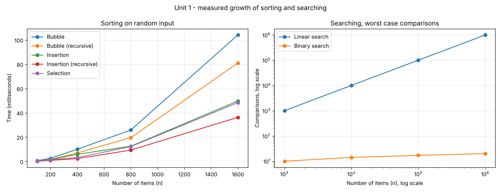

# Design and Analysis of Algorithms — Lab Practicals

**Kartik Gurjar** — Roll No. **IC-2K23-48**
MCA, Semester 7

Python implementations of the Design and Analysis of Algorithms lab
practicals. Each program prints its working step by step and reports the
operation counts that its complexity analysis predicts.

## Contents

| Unit | Topic | Programs |
|:---:|---|:---:|
| 1 | [Introduction to Algorithms](Unit01-Introduction-Algorithms/) — sorting, searching, complexity | 9 |

## Unit 1 — Introduction to Algorithms

| Program | Algorithm | Best | Worst | Space |
|---|---|:---:|:---:|:---:|
| `bubble_sort.py` | Bubble sort, iterative | O(n) | O(n²) | O(1) |
| `recursive_bubble_sort.py` | Bubble sort, recursive | O(n) | O(n²) | O(n) |
| `insertion_sort.py` | Insertion sort, iterative | O(n) | O(n²) | O(1) |
| `recursive_insertion_sort.py` | Insertion sort, recursive | O(n) | O(n²) | O(n) |
| `selection_sort.py` | Selection sort | O(n²) | O(n²) | O(1) |
| `linear_search.py` | Linear search | O(1) | O(n) | O(1) |
| `iterative_binary_search.py` | Binary search, iterative | O(1) | O(log n) | O(1) |
| `recursive_binary_search.py` | Binary search, recursive | O(1) | O(log n) | O(log n) |
| `complexity_analyser.py` | Times all of the above and checks them against theory | | | |



## Running the programs

Python 3.8 or later. Nothing to install, except that the analyser draws
its chart only if matplotlib is present (`pip install matplotlib`).

```bash
cd Unit01-Introduction-Algorithms
python3 bubble_sort.py
python3 complexity_analyser.py
```

## Author

**Kartik Gurjar**
Roll No. IC-2K23-48 · MCA Semester 5
GitHub: [@itskartikk](https://github.com/itskartikk)

Submitted as part of the Design and Analysis of Algorithms Laboratory coursework.
