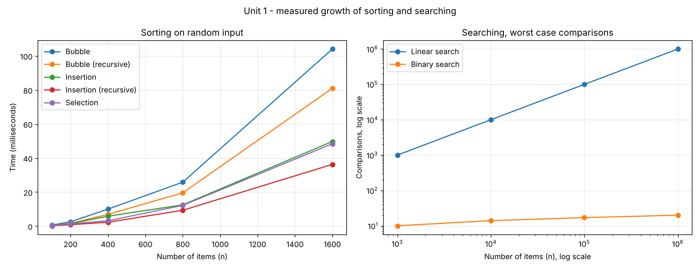

# Unit 1 — Introduction to Algorithms

**Kartik Gurjar** — IC-2K23-48

Three simple sorts, two searches, the recursive form of each where it has
one, and a program that measures them all.

| # | Program | What it shows |
|:---:|---|---|
| 1 | `bubble_sort.py` | Adjacent swaps, and the early exit that gives an O(n) best case |
| 2 | `recursive_bubble_sort.py` | The outer loop replaced by recursion |
| 3 | `insertion_sort.py` | Growing a sorted prefix by shifting |
| 4 | `recursive_insertion_sort.py` | Sort n-1 items, then insert the nth |
| 5 | `selection_sort.py` | Fewest swaps, but no best case, and not stable |
| 6 | `linear_search.py` | Works on unsorted data, O(n) |
| 7 | `iterative_binary_search.py` | Halving a sorted list, O(log n) |
| 8 | `recursive_binary_search.py` | The same halving as a recurrence |
| 9 | `complexity_analyser.py` | Timings and the doubling test |

---

## Sorting

### Bubble sort

Compare each pair of neighbours and swap them if they are out of order.
After one pass the largest value is at the end, so each pass can stop one
position earlier. If a pass makes no swap the list is sorted and the
function stops.

On 8 items: sorted input takes 1 pass and 7 comparisons; reverse input
takes 7 passes and 28 comparisons, which is n(n-1)/2.

**Recursive version.** One call does one pass, then calls itself on the
first n-1 items.

```
T(n) = T(n-1) + (n-1)   =>   O(n²)
```

The time is the same. The cost is memory: one stack frame per pass, so
O(n) space against O(1), and Python's recursion limit caps the list size.

### Insertion sort

Keep the left part sorted. Take the next value, shift the larger values
one place right, and put it in the gap. Sorted input needs n-1
comparisons and no shifts; reverse input needs n(n-1)/2 of each.

**Recursive version.** Sort the first n-1 items, then insert the nth.
The recursive call comes first, so the calls go all the way down to
n = 1 and the inserting happens as they return.

```
T(n) = T(n-1) + O(n)   =>   O(n²)
```

### Selection sort

Find the smallest value in the unsorted part and swap it into place.

It always makes n(n-1)/2 comparisons, whatever the input, so it has no
good best case. In exchange it makes at most n-1 swaps, the fewest of
the three.

It is **not stable**. The program shows `(4,'a'), (4,'b'), (1,'c')`
coming out as `(1,'c'), (4,'b'), (4,'a')`: the two 4s have changed order.

### Comparison

| | Best | Average | Worst | Space | Stable |
|---|:---:|:---:|:---:|:---:|:---:|
| Bubble | O(n) | O(n²) | O(n²) | O(1) | yes |
| Insertion | O(n) | O(n²) | O(n²) | O(1) | yes |
| Selection | O(n²) | O(n²) | O(n²) | O(1) | no |
| Recursive bubble / insertion | O(n) | O(n²) | O(n²) | O(n) | yes |

---

## Searching

### Linear search

Check every item in turn. The list does not need to be sorted. A
successful search takes (n+1)/2 comparisons on average; a failed one
takes n.

### Binary search

Needs a sorted list. Compare the target with the middle item and discard
the half that cannot contain it.

```
T(n) = T(n/2) + O(1)   =>   O(log n)
```

| Items | Binary search, worst case | Linear search, worst case |
|---:|:---:|---:|
| 1,000 | 10 | 1,000 |
| 10,000 | 14 | 10,000 |
| 100,000 | 17 | 100,000 |
| 1,000,000 | 20 | 1,000,000 |

The iterative version uses O(1) space. The recursive version uses
O(log n) for its call stack and runs slightly slower because of the
function calls.

---

## Complexity analyser

Times every algorithm on growing inputs and applies the **doubling
test**: double n and look at the ratio of the times.

| Ratio when n doubles | Growth |
|:---:|:---:|
| about 2x | O(n) |
| about 4x | O(n²) |

What it finds:

- On random and reverse-sorted input, every sort comes out near 4x.
- On already sorted input, bubble and insertion drop to about 2x, their
  O(n) best case. Selection stays near 4x.
- Linear search time grows 10x when n grows 10x. Binary search adds 3 or
  4 comparisons.

Each timing is the best of 3 runs on a fresh copy of the same list. The
times themselves depend on the machine; the ratios are what matter.



---

## Running them

```bash
python3 bubble_sort.py
python3 recursive_bubble_sort.py
python3 insertion_sort.py
python3 recursive_insertion_sort.py
python3 selection_sort.py
python3 linear_search.py
python3 iterative_binary_search.py
python3 recursive_binary_search.py
python3 complexity_analyser.py     # optional chart: pip install matplotlib
```
